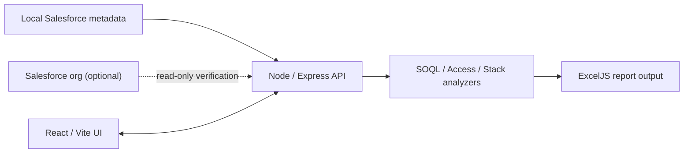

# Salesforce Repository Analyzer

**Local-first Salesforce security analysis, with optional live-org permission verification.**

[](https://github.com/Shubhamu68/SalesforceRepositoryAnalyzer/actions/workflows/analyzer-regression.yml)
[](https://github.com/Shubhamu68/SalesforceRepositoryAnalyzer/actions/workflows/windows-portable.yml)

Analyze Salesforce metadata and Apex queries by business persona, understand object/field access, investigate stack traces, and export concise Excel findings. The React UI is served locally by a Node/Express API; connected-org checks are optional where supported.

> **Project status:** Active development (`v0.1.0` in `package.json`). This repository is private. Releases are published separately after testing and approval; the latest source is not automatically the latest portable release.

## Features

| Capability | What it does |
| --- | --- |
| **SOQL Security Analysis** | Scans Apex SOQL, resolves parent/child fields and aggregates, checks object/field Read access by persona and query mode, and creates one Excel Summary workbook. |
| **Access Checker** | Explains effective object or field access, including Profile, Permission Set, PSG, and optional org-verification evidence. |
| **Object Access Matrix** | Compares object Read/Create/Edit/Delete and elevated privileges across configured personas. |
| **Stack Trace Impact Analyzer** | Follows Apex stack-trace call paths to identify relevant queries and permission risks. |
| **Salesforce Org Verification** | Uses configured credentials to supplement repository permissions and investigate uncertain access; distinguishes grants, denials, and Review. |
| **Windows Portable Edition** | Bundles its own Node runtime; extract, double-click the launcher, and use the app in a local browser. |

This is a **static repository analyzer**, not a replacement for Salesforce's runtime authorization engine. Unsupported query constructs and incomplete org evidence should remain Review, not automatic permission grants.

## Quick start

### Windows portable — no Node.js installation required

1. Open [Releases](https://github.com/Shubhamu68/SalesforceRepositoryAnalyzer/releases) and select an **approved** version containing `SalesforceRepositoryAnalyzer-Windows-Portable.zip`. Until the first release exists, an authorized developer can generate a build from [Build Windows Portable Analyzer](https://github.com/Shubhamu68/SalesforceRepositoryAnalyzer/actions/workflows/windows-portable.yml).
2. Extract the **complete** ZIP to a writable directory on Windows 10/11.
3. Double-click **`Start Analyzer.cmd`**; the local UI opens in your default browser.
4. When prompted, choose the root of a Salesforce metadata repository containing `force-app/main/default`. Choose a writable Excel output folder when first analyzing SOQL.
5. Optionally configure approved Salesforce credentials in your **local**, untracked `.env` file.

Keep the launcher console open while using the tool. For troubleshooting and safe credential handling, see [Windows Portable Setup](docs/setup/windows-portable.md).

### Developer setup

Prerequisites: Node.js **24**, npm, a Salesforce metadata checkout, and PowerShell for the Windows folder dialogs.

```powershell
git clone https://github.com/Shubhamu68/SalesforceRepositoryAnalyzer.git
cd SalesforceRepositoryAnalyzer
npm ci
npm run api
```

In a second terminal:

```powershell
cd web
npm ci
npm run dev
```

Open the Vite local URL printed in the terminal. The frontend proxies `/api` requests to the local Express server (default `localhost:3000`). The UI can prompt for a repository path and output folder; see [Development Setup](docs/setup/development.md).

## How the pieces fit



- **Backend:** TypeScript, Node.js, Express, SOQL parser, XML metadata parsing and ExcelJS.
- **Frontend:** React, TypeScript and Vite.
- **Input:** Repository metadata for Apex, Profiles, Permission Sets, PSGs and schema; optional live Salesforce effective-access evidence.
- **Output:** Local analysis results and Excel workbooks. The tool does not deploy permission changes to Salesforce.
- **Portability:** No project-specific field-permissionability export is bundled. Current-org metadata is resolved live when available; repository-only unknown fields remain Review unless explicitly configured with a matching-org local cache.

Read [Architecture](docs/architecture.md) for the module-level flow.

## Common commands

| Command | Purpose |
| --- | --- |
| `npm run api` | Start the development API |
| `cd web && npm run dev` | Start the React development UI |
| `npm run analyze` | Run the existing CLI analysis |
| `npm run build` | Compile the backend TypeScript |
| `npm run test:all` | Run all backend regression tests |
| `cd web && npm run build` | Build the frontend |
| `cd web && npm run lint` | Lint the frontend |

## Documentation

- [Documentation index](docs/README.md) — feature notes, setup and historical implementation material
- [Development setup](docs/setup/development.md) · [Windows portable](docs/setup/windows-portable.md)
- [Architecture](docs/architecture.md) · [SOQL aggregate analysis](docs/features/soql-aggregates.md)
- [Release process](docs/releases.md) · [Changelog](CHANGELOG.md)
- [Contributing and PR checks](CONTRIBUTING.md) · [Security practices](docs/security.md)

## Security and limitations

- Never commit `.env`, credentials, org access tokens or proprietary Salesforce records. The Windows ZIP intentionally packages only `.env.example`.
- The portable launcher runs **locally in your browser**; it is not an Electron app and does not require recipients to install Node/npm.
- Salesforce org verification requires an approved client-credentials integration and authorized permissions. Repository-only mode can still be used where supported.
- All changes to analyzed repositories or org permissions must be reviewed separately; this tool is principally **read-only**.
- The repository is private; Releases and source access remain subject to GitHub repository permissions.

---
For issues or feature requests, use the [issue templates](https://github.com/Shubhamu68/SalesforceRepositoryAnalyzer/issues/new/choose). Please redact organization IDs, field values and credentials from reports or logs.
