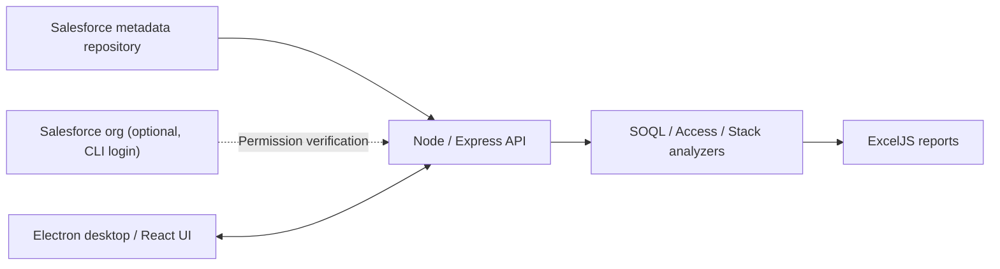

# Salesforce Repository Analyzer

**Local-first Salesforce repository security analysis, with optional live-org permission verification.**

[](https://github.com/Shubhamu68/SalesforceRepositoryAnalyzer/actions/workflows/analyzer-regression.yml)
[](https://github.com/Shubhamu68/SalesforceRepositoryAnalyzer/actions/workflows/windows-desktop.yml)

Analyze Salesforce Apex SOQL and metadata by business persona, understand object and field access, investigate stack traces, and export Excel findings. The application runs locally; Salesforce org verification is optional.

> **Project status:** Public source repository; active development. The source package version is **0.1.1**. No official `v0.1.0` GitHub Release has been published yet. The Electron desktop-folder ZIP shared with initial recipients is a **separately distributed build**, not an official GitHub Release. Changes to `main` do not update previously shared ZIPs.

## Getting started — Windows desktop (Electron)

**For recipients of the desktop-folder ZIP:** use these instructions, not the browser-based portable launcher.

1. Obtain the approved **`SalesforceRepositoryAnalyzer-Desktop-Unpacked.zip`** shared with your team. Maintainers can also build a test artifact using [Build Windows Desktop Folder ZIP](https://github.com/Shubhamu68/SalesforceRepositoryAnalyzer/actions/workflows/windows-desktop.yml).
2. **Extract the entire ZIP.** Open the extracted `win-unpacked` folder.
3. Double-click **`Salesforce Repository Analyzer.exe`**. Keep the EXE, DLLs, `resources` folder and other extracted files together; this is a folder-based app, **not an installer or a standalone EXE**.
4. Select the root of the Salesforce metadata repository you want to analyze (containing `force-app/main/default`). Choose a writable Excel output folder when prompted.
5. To verify access against a Salesforce org, install **Salesforce CLI v2.136.0+** and select an authorized CLI org or sign in through the app's Salesforce browser-login option. Alternatively, continue with repository-only analysis where supported.

**Requirements:** Windows 10/11. No separate Node.js, npm, Git, or VS Code installation is needed to **run** the desktop application. You will need local Salesforce metadata to analyze. Salesforce CLI is required **only** for optional connected-org features.

**Security notice:** The desktop executable is currently **unsigned**. Follow your organization's software approval process if Windows SmartScreen or endpoint protection blocks it; do not bypass company controls.

See the [Windows desktop setup and troubleshooting guide](docs/setup/windows-desktop.md) for the full instructions. For the separate `Start Analyzer.cmd` browser-based distribution, see [Windows portable setup](docs/setup/windows-portable.md).

## Features

| Capability | What it does |
| --- | --- |
| **SOQL Security Analysis** | Scans static and supported dynamic Apex SOQL, including caller- and metadata-backed query reconstruction; evaluates object/field Read access by persona and execution mode and exports an Excel Summary workbook with explicit coverage limitations. |
| **Access Checker** | Shows effective object and field permissions with supporting Profile, Permission Set, Permission Set Group, and optional org-verification evidence. |
| **Object Access Matrix** | Compares object Read/Create/Edit/Delete and elevated privileges across configured personas. |
| **Stack Trace Impact Analyzer** | Investigates Apex stack-trace call paths, static SOQL and potential permission issues. Shared dynamic AUE integration is planned for v0.1.2. |
| **Optional Salesforce Org Verification** | Supplements repository-based conclusions with authorized Salesforce org evidence, distinguishing granted, denied, and inconclusive results. |
| **Excel Reporting** | Produces local workbooks for review without changing Salesforce permissions or data. |

### How permissions and org authentication work

- Repository metadata (Profiles, Permission Sets, Permission Set Groups, schema and Apex) is the baseline for analysis.
- **Salesforce CLI owns optional OAuth authorization.** Use a saved CLI org or the official Salesforce browser sign-in. The Analyzer does **not** ask for your Salesforce password or require an Analyzer-specific client ID/client secret.
- The connected session is scoped to the selected org/user; use an appropriately authorized account.
- The results are *analysis evidence*, not a substitute for Salesforce's runtime authorization checks. Unsupported dynamic SOQL, incomplete metadata and uncertain effective permissions may be reported as **Review** rather than treated as definite grants or denials.

## Architecture



- **Analysis backend:** TypeScript, Node.js, Express, SOQL parser, XML metadata parsing, and ExcelJS.
- **UI:** React, TypeScript, Vite; hosted locally by the bundled API in the Electron desktop app.
- **Distribution:** Electron folder ZIP bundles application dependencies and Node runtime; no project Salesforce metadata or user credentials are packaged.
- **Output:** Local Excel workbooks. See [Architecture](docs/architecture.md) for module-level details.

## Developer setup

Developers (unlike desktop recipients) need Node.js **24**, npm and Git. From a terminal:

```powershell
git clone https://github.com/Shubhamu68/SalesforceRepositoryAnalyzer.git
cd SalesforceRepositoryAnalyzer
npm ci
Copy-Item .env.example .env
npm run api
```

In a second terminal:

```powershell
cd web
npm ci
npm run dev
```

Open the Vite URL displayed by the frontend. For desktop packaging, tests, or optional Salesforce CLI setup, see [Development setup](docs/setup/development.md) and [Electron desktop build notes](desktop/electron/README.md).

| Command | Purpose |
| --- | --- |
| `npm run api` | Development API |
| `cd web && npm run dev` | Development React UI |
| `npm run analyze` | CLI analyzer |
| `npm run build` | Backend TypeScript compilation |
| `npm run test:all` | Backend regression tests |
| `cd web && npm run build` | Frontend production build |
| `cd web && npm run lint` | Frontend linting |

## Documentation

- [Documentation index](docs/README.md)
- [Windows desktop setup](docs/setup/windows-desktop.md) · [Windows portable/browser setup](docs/setup/windows-portable.md) · [Development setup](docs/setup/development.md)
- [Architecture](docs/architecture.md) · [SOQL aggregate analysis](docs/features/soql-aggregates.md)
- [Release and build distribution](docs/releases.md) · [Changelog](CHANGELOG.md)
- [Contributing](CONTRIBUTING.md) · [Security practices](docs/security.md)

## Security, scope and licensing

- Never commit `.env`, Salesforce tokens, CLI authorization files, proprietary customer metadata or real customer records. Public issues and screenshots must be sanitized.
- Desktop settings are created **per user** outside the shared ZIP; the distribution includes `.env.example`, not someone else's credentials.
- The application is primarily read-only and does not deploy permission changes to Salesforce.
- **Public source visibility is not a software license.** No root `LICENSE` file is included at present; contact the repository owner for reuse or redistribution permissions.
- For bugs and feedback, use [GitHub Issues](https://github.com/Shubhamu68/SalesforceRepositoryAnalyzer/issues/new/choose) without exposing organization-specific data or secrets.

> **Build/version note:** The public `main` branch may contain development changes beyond the separately emailed v0.1.0 ZIP. Verify the exact source commit used for a distributed build before describing it as an official versioned release.

**Packaging distinction:** The browser-portable launcher is not an Electron app; the separate Windows desktop-folder ZIP is an Electron application.

## In-progress v0.1.1 dynamic SOQL analysis

The [dynamic SOQL design and implementation notes](docs/features/dynamic-soql-resolution-v011.md) describe the bounded Apex dependency resolver, query variants, metadata support and limitations. This is a draft feature, not a release of the **Windows Portable** launcher or the Windows desktop package. Unknown runtime fields and incomplete metadata remain Unable to verify.
