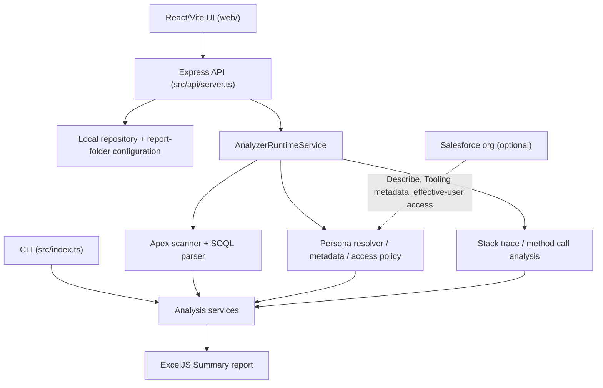

# Architecture

Salesforce Repository Analyzer is a **local application** with a React frontend, Express API, TypeScript analysis services and optional Salesforce org verification. The same analyzers can also be exercised through CLI commands.

## Key directories

| Path | Responsibility |
| --- | --- |
| `src/api/server.ts` | HTTP endpoints and packaged React static serving |
| `src/services/AnalyzerRuntimeService.ts` | Shared repository-scoped analysis services |
| `src/scanner/` | Salesforce metadata and Apex query/method extraction |
| `src/analyzer/` | Recursive SOQL relationships, fields, query modes, permissions |
| `src/salesforce/` | Optional org connection and metadata-backed permission checks |
| `src/services/` | Analysis orchestration, paths/configuration and output |
| `src/reporter/` | Excel Summary report generation |
| `config/` | Persona and supporting metadata/policy configuration |
| `web/` | React/Vite user interface |
| `desktop/windows/` | Portable double-click launcher and smoke test |
| `tests/` | Regression tests discovered automatically by `npm run test:all` |

## How a SOQL analysis runs

1. Validate the configured Salesforce repository and select a business persona.
2. Discover Apex SOQL and infer query execution mode.
3. Collect referenced objects and fields, including aggregates, parent/child relationships, and nested scopes.
4. Evaluate Profile, Permission Set, Permission Set Group, schema and field permissionability rules.
5. Where configured, verify uncertain access through authorized live Salesforce metadata/user checks.
6. Distinguish confirmed missing permissions from inconclusive `Review` results and produce an Excel Summary workbook.

Source metadata and live-org evidence are distinct. A missing permission entry in one XML file is not proof of an effective Salesforce denial.

## Local and packaged execution

Development runs Vite and Express separately. The Windows portable build uses the same compiled Express API to serve the Vite production UI, via a bundled `node.exe` and local loopback URL. The packaged ZIP does not include the source Salesforce repository or secret-filled `.env` files.

## Scope and caveats

- The Analyzer is primarily static and **read-only** with respect to Salesforce data, permissions and configuration.
- Access decisions use a centralized evaluator to reduce inconsistent rules across features.
- A verified org permission does not replace object-level authorization checks; `Review` means incomplete evidence, not a denied grant.
- Unsupported Apex patterns, dynamic SOQL, and complex call flows can limit certainty. Regression tests help prevent known false positives; they do not guarantee complete Apex language coverage.
