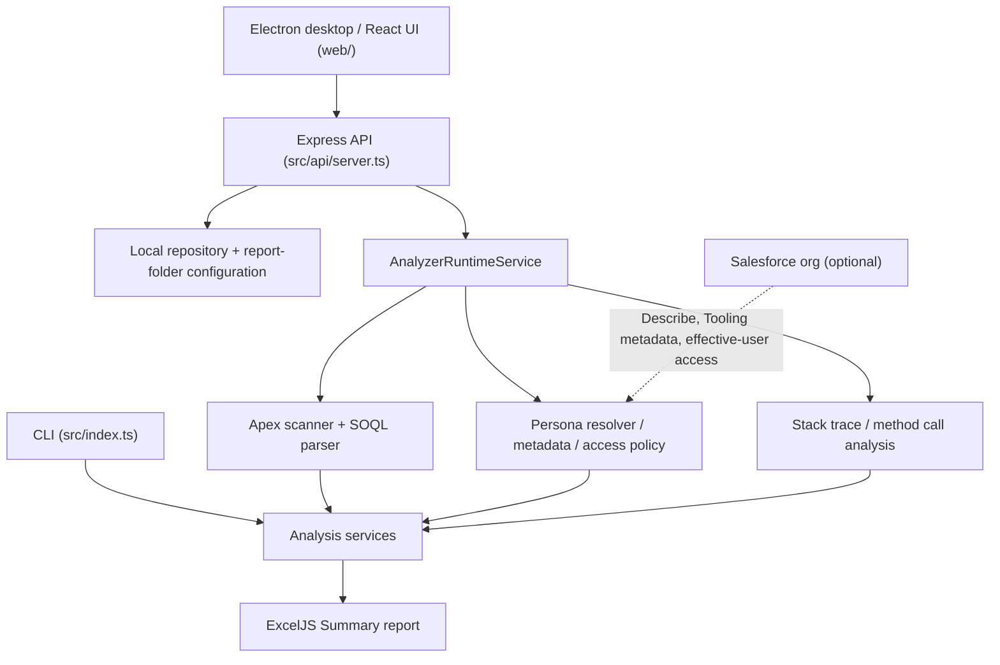

# Architecture

Salesforce Repository Analyzer is a **local application** with a React frontend, Express API, TypeScript analysis services and optional Salesforce org verification. The same analyzers can also be exercised through CLI commands.

## Key directories

| Path | Responsibility |
| --- | --- |
| `src/api/server.ts` | HTTP endpoints and packaged React static serving |
| `src/services/AnalyzerRuntimeService.ts` | Shared repository-scoped analysis services |
| `src/scanner/` | Salesforce metadata and Apex query/method extraction |
| `src/analyzer/` | Recursive SOQL relationships, fields, query modes, permissions |
| `src/salesforce/` | Optional org connection and metadata-backed permission checks |
| `src/services/` | Analysis orchestration, paths/configuration and output |
| `src/reporter/` | Excel Summary report generation |
| `config/` | Persona and supporting metadata/policy configuration |
| `web/` | React/Vite user interface |
| `desktop/electron/` | Electron desktop folder ZIP, packaged launcher and smoke tests |
| `desktop/windows/` | Separate browser-portable launcher and smoke test |
| `tests/` | Regression tests discovered automatically by `npm run test:all` |

## How a SOQL analysis runs

1. Validate the configured Salesforce repository and select a business persona.
2. Discover Apex SOQL and infer query execution mode.
3. Collect referenced objects and fields, including aggregates, parent/child relationships, and nested scopes.
4. Evaluate Profile, Permission Set, Permission Set Group, schema and field permissionability rules.
5. Where configured, verify uncertain access through authorized live Salesforce metadata/user checks.
6. Distinguish confirmed missing permissions from inconclusive `Review` results and produce an Excel Summary workbook.

Source metadata and live-org evidence are distinct. A missing permission entry in one XML file is not proof of an effective Salesforce denial.

## Local and packaged execution

Development runs Vite and Express separately. The **Electron desktop-folder ZIP** wraps the compiled Express API and React UI in a native desktop window and bundles a Node runtime; users must extract and retain the complete `win-unpacked` folder, including the EXE, DLLs and `resources`. The separate **browser-portable** build uses `Start Analyzer.cmd` and a browser with the same local API and bundled runtime. Neither ZIP should include the source Salesforce repository, individual CLI auth files or a real `.env`.

Optional Salesforce verification is authenticated through **Salesforce CLI-managed browser OAuth** (`sf` v2.136.0+ on the user machine). A separate client ID/client secret is not required by the Analyzer. See [Windows desktop setup](setup/windows-desktop.md), [Development setup](setup/development.md) and [Security](security.md).

## Scope and caveats

- The Analyzer is primarily static and **read-only** with respect to Salesforce data, permissions and configuration.
- Access decisions use a centralized evaluator to reduce inconsistent rules across features.
- A verified org permission does not replace object-level authorization checks; `Review` means incomplete evidence, not a denied grant.
- Unsupported Apex patterns, dynamic SOQL, and complex call flows can limit certainty. Regression tests help prevent known false positives; they do not guarantee complete Apex language coverage.

## Dynamic SOQL v0.1.1 (feature branch)

The [dynamic SOQL architecture](features/dynamic-soql-resolution-v011.md) isolates Apex source parsing, bounded field-list/value tracing and read-only metadata adapters from the persona permission engine. Fully reconstructed variants and individually validated permission evidence enter the existing OLS/FLS evaluator; unresolved execution paths retain explicit REVIEW findings. This feature remains under review.

## Shared source dependency evidence (SOQL, future DML and other consumers)

The generic Apex Understanding Engine is under `src/core/apex/`. Its bounded execution evaluator and backward source dependency tracer are complementary: execution candidates preserve the existing runtime reconstruction rules, while `ApexBackwardDependencyEngine` follows lexical definitions, assignments, caller arguments, collection additions, supported loops and metadata dependencies to produce **SOURCE_CANDIDATES**, not exact runtime values. No permission decisions or synthetic query text are stored in the shared execution caches.

| Shared Apex responsibility | Module |
| --- | --- |
| Backward dependencies and caller/row correlation | ApexBackwardDependencyEngine, ApexRepositoryMethodIndex |
| Literal IF/ELSE and SWITCH return evidence | ApexLiteralReturnEvidence |
| Straight-line caller String templates | ApexCallerStringTemplate |
| Typed wrapper members and fixed ISO formatter | ApexSourceValueProofs |
| Read-only label-backed collection provenance | ApexLabelCollectionEvidence |
| API-version metadata | ApexApiVersionIndex |
| Source syntax, symbols, execution, effects and metadata access | Existing Apex* and core/metadata modules |

The backward engine exposes consumer hooks for runtime expression abstraction, join annotations and conditional String append merging. It does not import any analyzer, SOQL grammar, permission or report module. The default consumer does not interpret conditional String fragments or broaden unknown metadata selections. All-row configuration candidates are an explicit opt-in; metadata retrieval remains read-only and row-correlated. Add-only collection unions are potential source evidence, not claims of runtime equality.

SOQL adapters own SELECT/WHERE/ORDER usage, typed parser placeholders, query grammar validation, field/object/mode grouping, and read-mode enforcement. The persona resolver, object/field permission aggregation, relationship metadata, field permissionability and org access gateways remain shared services. A future DML analyzer will supply its own operation selector, record/field-write evidence and CRUD/FLS enforcement rules; it must not use parser-only SOQL placeholders or treat Id as a field update merely because it identifies a record.

### Architecture audit and remaining boundaries

- The existing Apex invocation selector compatibility helpers and metadata query parser describe Apex syntax/metadata access, not SOQL permission policy. No change to the existing execution budgets or caller sampling.
- Stack Trace still has a separate older method/call scanner and static SOQL extraction. Its migration to shared source indexing and dynamic evidence is tracked by issue #58; no change to its reachability semantics in this refactor.
- Repository CRUD/read/edit permission aggregation is shared already. OrgObjectReadVerificationService, SOQL runtime impact, platform-event exclusions and read-specific status-neutral evidence are not a generic DML policy. Future DML must reuse the underlying operation-aware permission and metadata primitives, explicitly validate write permissionability and define create/update/delete/upsert/merge semantics. Do not extrapolate write authorization from read verification.
- `SoqlPerformanceMetrics` still hosts the current request-scoped SOQL telemetry sink; shared Apex backward counters now use `apex.backward.*` rather than `apex.soql.backward.*`. A future consumer can bind its own ApexPerformance sink. No UI/report format change.
- The remaining SOQL-specific source builder handles literal query fragments and grammar-specific branch aggregation; do not move grammar-specific behavior into Apex. Constructor/lifecycle expansion remains deferred.
